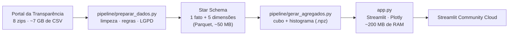

# ✈️ Radar de Viagens Públicas

**Auditoria cidadã das viagens a serviço do Governo Federal (2019–2026).**
Quanto se gasta, quem gasta, como gasta e quais viagens merecem revisão: 5,08 milhões de viagens do
Portal da Transparência, organizadas para responder em segundos.

🔗 **Painel:** https://auditoria-viagens-publicas-projeto.streamlit.app/

Projeto da disciplina **Análise de Dados e Big Data (A3)**, com entregáveis do **Ânima Hub**.

---

## 👥 Equipe

| Integrante | Curso |
|---|---|
| Ana Caroline Nascimento Gomes | Engenharia da Computação |
| Caique da Silva Miranda Santos | Ciência da Computação |
| Luana Ferreira Alves Dias Roriz | Engenharia da Computação |
| Weslley Dalcol Leite | Direito |
| Yago de Souza Steinmetz | Ciência da Computação |

Repositório principal: [gomes0705/auditoria-viagens-publicas-projeto](https://github.com/gomes0705/auditoria-viagens-publicas-projeto)

---

## 💡 Principais achados

| # | Achado | Confiança |
|---|---|---|
| 1 | Em 2025 o gasto foi **1,38× o de 2019 já descontada a inflação** (1,92× nominal). A queda de 60% da pandemia foi totalmente revertida. | Alta |
| 2 | No mesmo período (jan–jun), **2026 gasta ~8% menos que 2025**: primeiro sinal de queda (ano ainda parcial). | Média |
| 3 | **1% das viagens concentra 19% do gasto**; viagens com mais de 30 dias são 2,2% das viagens e 20% do gasto. | Alta |
| 4 | **60% das viagens são urgentes** desde 2021, e custam ~11% mais. Urgência virou regra: sinal de falta de planejamento. | Média |
| 5 | Três órgãos somam 61% do gasto, mas por **volume**; comparar pela **taxa de casos atípicos por mil viagens** é mais justo. | Média |
| 6 | O campo de urgência **não era preenchido antes de jun/2020**: comparações com 2019 seriam falsas. | Alta |

Caso atípico é um **sinal para revisão**, não prova de irregularidade. A base não mede reuniões online, então não
afirmamos que o trabalho remoto causou a queda de 2020.

---

## 🏗️ Como funciona



- **Tratamento:** só viagens realizadas, IDs duplicados removidos, valores e datas convertidos, duração, custo/dia,
  escopo e UF do destino, meio de transporte principal e correção pelo **IPCA** (R$ de dez/2025).
- **LGPD:** nome, CPF e identificador do viajante são descartados no tratamento. O painel mostra só dados agregados
  e, nos casos para revisão, o número do processo (PCDP), que é público.
- **Modelo dimensional (Star Schema):** a tabela fato tem uma linha por viagem com as medidas; as dimensões guardam
  o contexto (tempo, órgão, destino, transporte e duração).
- **Camada agregada:** o painel não carrega as 5 milhões de viagens. Um cubo de ~400 mil linhas responde somas e taxas,
  e medianas e curva de Pareto vêm de estatísticas exatas (sem filtro) ou de um histograma de valores (com filtro,
  erro abaixo de 0,5%). O painel não carrega nenhum dado viagem a viagem e cabe na memória do plano gratuito.
- **Caso atípico:** viagem com log(custo/dia) acima de Q3 + 3×IQR entre viagens parecidas (mesmo ano, escopo, faixa de
  duração e com/sem avião), com valor ≥ R$ 1.000.

### Modelo de dados

| Tabela | Grão | Conteúdo |
|---|---|---|
| `fato_viagem` | 1 viagem realizada | chaves `sk_*` · diárias, passagens, outros, devolução, duração, urgente, outlier |
| `dim_tempo` | 1 dia | ano, mês, trimestre, dia da semana, fator IPCA |
| `dim_orgao` | 1 órgão superior | nome |
| `dim_destino` | escopo + UF | UF, região, coordenadas |
| `dim_modal` | 1 meio de transporte | meio, categoria |
| `dim_duracao` | 1 faixa | faixa, dias mín/máx |

---

## 🧭 O painel

| Página | Pergunta | Conteúdo |
|---|---|---|
| ✨ Resumo executivo | Visão de 30 segundos | KPIs com tendência e 6 cartões de insight (confiança e decisão) |
| 📈 Evolução | Quanto se gasta? | Gasto anual, comparação justa do ano parcial, composição, sazonalidade |
| 🏛️ Órgãos | Quem gasta? | Top 10, volume × ticket, tabela normalizada |
| 🧭 Perfil | Como gasta? | Duração × gasto, Pareto, meio de transporte, mapa por UF |
| 🚨 Radar de revisão | O que revisar? | Taxa de casos atípicos, urgentes × programadas, fila de revisão com PCDP |
| 📘 Metodologia | Como foi feito? | Star Schema, KPIs, pipeline e limites |

Filtros: período, órgão superior, escopo (nacional, internacional, sigiloso), urgência e correção pela inflação.

---

## 📁 Estrutura

```
app.py                         painel Streamlit (6 páginas)
data/
  fato_viagem_<ano>.parquet      tabela fato (Star Schema)
  dim_*.parquet                  5 dimensões
  casos_<ano>.parquet            detalhe dos casos para revisão (com PCDP)
  resumo_situacao.parquet        viagens realizadas × não realizadas (controle de qualidade)
  cubo_viagens.npz               camada agregada lida pelo painel
  histograma_valores.npz         viagens e gasto por faixa de valor (medianas e Pareto com filtro)
  estatisticas_exatas.json       medianas e Pareto exatos da base completa
pipeline/
  preparar_dados.py              zips brutos → Star Schema
  gerar_agregados.py             Star Schema → camada agregada
tratamento_e_analise.ipynb     processo completo: dados brutos → código → resultado → insights (+ .html)
apresentacao/                  slides, roteiro do pitch e relatórios
requirements.txt
.streamlit/config.toml         tema
```

---

## ▶️ Como rodar

```bash
pip install -r requirements.txt
streamlit run app.py
```

### Regerar os dados

Os zips brutos (~1 GB, 7 GB descompactados) **não vão para o GitHub**: cada um passa do limite de 100 MB.
Baixe-os em https://portaldatransparencia.gov.br/download-de-dados/viagens, coloque em `dados_brutos/`
(já ignorada pelo `.gitignore`) e rode:

```bash
python pipeline/preparar_dados.py --zips dados_brutos   # 1) Star Schema
python pipeline/gerar_agregados.py                      # 2) camada agregada usada pelo painel
```

### Deploy no Streamlit Community Cloud

1. Em share.streamlit.io, crie o app apontando para este repositório, branch e arquivo `app.py`.
2. A cada commit, o Streamlit Cloud redeploya sozinho; se não redeployar, use **Reboot app**.

**Se o app cair ("Oh no. Error running app"):** o plano gratuito encerra o app sem mensagem quando falta memória.
Esta versão foi feita para isso (~180 MB na abertura, ~220 MB estáveis com filtros; a primeira versão chegava a 1,5 GB).
Confira se o repositório tem o `app.py` atual e os arquivos `.npz` em `data/`, use **Reboot app** e, se persistir,
baixe os logs em *Manage app*.

---

## 🤝 Como contribuir (fluxo do fork)

1. Faça um fork de [gomes0705/auditoria-viagens-publicas-projeto](https://github.com/gomes0705/auditoria-viagens-publicas-projeto) e clone.
2. Crie uma branch por mudança (`git checkout -b minha-mudanca`) e faça commits pequenos e descritivos.
3. Rode o app localmente antes de subir.
4. Abra um Pull Request para o repositório principal.

---

## 📚 Fonte e referências

- Portal da Transparência (CGU), Viagens a Serviço: https://portaldatransparencia.gov.br/download-de-dados/viagens
- IBGE, IPCA anual (correção monetária)
- Kimball, R.; Ross, M. *The Data Warehouse Toolkit* (modelagem dimensional)
- Tukey, J. W. *Exploratory Data Analysis* (regra do IQR)
